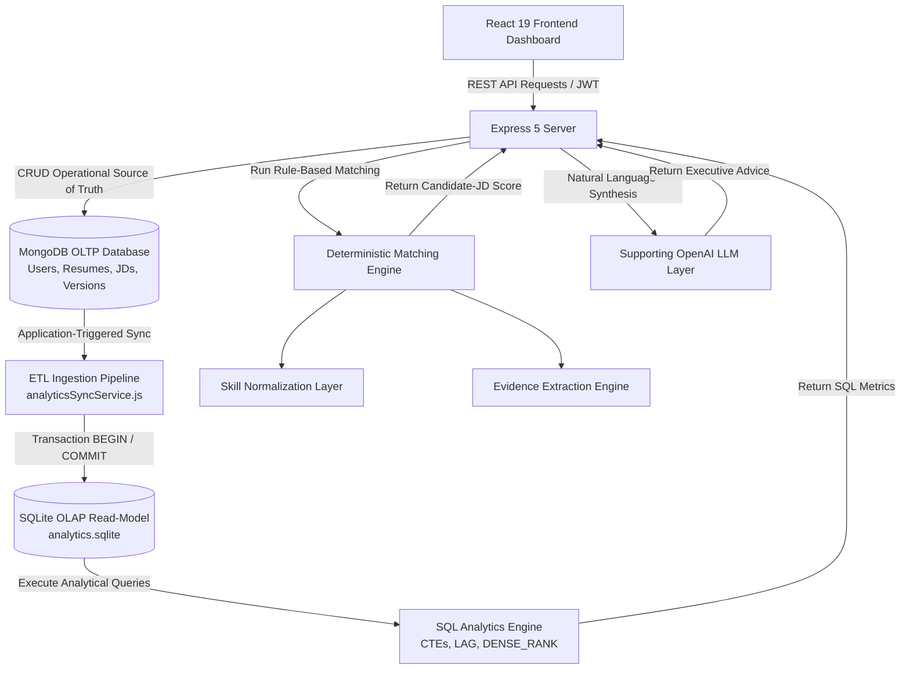

# Career Intelligence & Resume Analytics Platform

An enterprise-grade, interview-defensible analytics platform that bridges resume management, job description (JD) intelligence, deterministic skill normalization, evidence-backed candidate-JD match scoring, skill gap analysis, relational SQL analytics, and supporting LLM recommendations.

Aligned for **Business Technology**, **Data Analytics**, and **Technology Consulting** roles (e.g., *ZS Business Technology Solutions Associate — BTSA*).

---

## Overview

### The Problem
Candidates frequently struggle to evaluate how well their resumes align with target job descriptions. Traditional tools rely either on simple keyword counting or black-box LLM prompts that generate non-deterministic, unexplainable match percentages without auditability or underlying relational analytics.

### What the Platform Does
The **Career Intelligence & Resume Analytics Platform** provides an empirical, data-driven approach to career intelligence:
1. **Parses & Structures** resumes and job descriptions into queryable JSON schemas.
2. **Normalizes Skills** using a deterministic canonical taxonomy dictionary (resolving variations like `"Postgres"` and `"PostgreSQL DB"` to `"POSTGRESQL"`).
3. **Extracts Evidence** from narrative lines in candidate experience and projects, rating evidence strength (`Strong`, `Moderate`, `Weak`, `None`).
4. **Calculates Match Scores** programmatically using transparent, configurable heuristic weights across 5 dimensions.
5. **Synchronizes Analytics** to an isolated relational SQLite database via application-triggered ETL.
6. **Executes SQL Analytics** utilizing CTEs and Window Functions (`LAG()`, `DENSE_RANK()`) to evaluate skill demand, category coverage, and resume version progression.
7. **Synthesizes Advice** via a supporting OpenAI LLM layer for natural-language recommendations grounded strictly in calculated data.

---

## Key Capabilities

### Resume & Job Description Processing
- Converts raw resume inputs (manual forms or PDF uploads) into structured JSON documents containing `personal_info`, `professional_summary`, `skills[]`, `experience[]`, `project[]`, and `education[]`.
- Extracts structured requirements from target Job Descriptions: `technicalSkills[]`, `softSkills[]`, `tools[]`, `domainSkills[]`, `experienceYears`, and `educationLevel`.

---

### Skill Normalization Layer
Normalizes messy, user-entered skill strings and job requirement variations into canonical uppercase entities using an explicit mapping dictionary ([`normalizationService.js`](file:///Users/piyushkumarmishra/Documents/AI%20Resume%20Builder/server/services/normalizationService.js)):

| Raw Input Variation | Canonical Skill Name | Assigned Category |
| :--- | :--- | :--- |
| `"Postgres"`, `"PostgreSQL DB"`, `"psql"` | `POSTGRESQL` | Technical |
| `"PowerBI"`, `"Power BI"`, `"power-bi"` | `POWER BI` | Tool |
| `"ml"`, `"machine-learning"` | `MACHINE LEARNING` | Domain |
| `"py"`, `"python3"` | `PYTHON` | Technical |
| `"requirement gathering"`, `"business requirements"` | `BUSINESS REQUIREMENTS` | Soft Skill |

Unmapped or custom skills fall back to clean uppercase formatting (e.g., `"Julia"` $\rightarrow$ `"JULIA"`).

---

### Evidence-Based Matching Engine
Matching does not rely on simple keyword existence in a skills list. The evidence engine ([`evidenceService.js`](file:///Users/piyushkumarmishra/Documents/AI%20Resume%20Builder/server/services/evidenceService.js)) scans candidate experience and project narrative lines to extract direct quote evidence and classify **Evidence Strength**:

- **`Strong`**: Skill keyword matches a line in Experience or Projects AND matches regular expressions for quantified metrics (`METRIC_REGEX`: `45%`, `$50k`, `10k requests`) or active verbs (`ACTION_VERB_REGEX`: `built`, `optimized`, `designed`, `implemented`).
- **`Moderate`**: Skill keyword matches an Experience/Projects narrative line without explicit metrics/action verbs, OR appears in the Professional Summary.
- **`Weak`**: Skill keyword is NOT found in narrative lines, but matches an entry in the candidate's `skills` list array.
- **`None`**: Skill keyword is not found anywhere in the resume.

> [!NOTE]
> **Implementation Transparency & Known Limitations:** The evidence classifier is deterministic and explainable. It uses regex pattern matching rather than deep semantic NLP parser trees. As a result, action verb matches (e.g., *"built"*) trigger `Strong` classification regardless of full sentence syntax, and unlisted action verbs (e.g., *"spearheaded"*) without metrics default to `Moderate`.

---

### Deterministic Candidate-JD Match Scoring
The **Candidate-JD Match Score** is calculated programmatically in Javascript ([`matchingService.js`](file:///Users/piyushkumarmishra/Documents/AI%20Resume%20Builder/server/services/matchingService.js)). The formula uses 5 transparent, configurable heuristic weights:

$$\text{Candidate-JD Match Score} = (W_{tech} \times S_{tech}) + (W_{soft} \times S_{soft}) + (W_{exp} \times S_{exp}) + (W_{proj} \times S_{proj}) + (W_{edu} \times S_{edu})$$

#### Configurable Baseline Heuristic Weights

| Dimension | Default Weight | Objective & Sub-Score Logic ($S_{dim}$) |
| :--- | :--- | :--- |
| **Technical Skill Coverage ($S_{tech}$)** | **40%** | Ratio of required JD technical/tool/domain skills satisfied (`Strong` = 1.0pt, `Moderate` = 0.85pt, `Partial/Weak` = 0.50pt). |
| **Soft Skill Coverage ($S_{soft}$)** | **15%** | Ratio of required soft skills present in candidate profile (`Matched` = 1.0pt, `Partial` = 0.5pt). |
| **Experience Alignment ($S_{exp}$)** | **20%** | Evaluates total estimated experience years against required JD experience years. |
| **Project Evidence ($S_{proj}$)** | **15%** | Evaluates presence of candidate projects and strong project-level skill evidence. |
| **Education & Certifications ($S_{edu}$)** | **10%** | Verifies presence of degree level and relevant institution details. |

> [!IMPORTANT]
> These weights represent **configurable baseline heuristic initial weights** for Business Technology and Analytics roles. They do not claim to represent a universal, immutable ATS industry formula. Numerical scores are calculated 100% programmatically and do **NOT** depend on LLM outputs.

---

### Resume Version Analytics
Candidates can save explicit version snapshots (v1, v2, v3) of their resume ([`ResumeVersion.js`](file:///Users/piyushkumarmishra/Documents/AI%20Resume%20Builder/server/models/ResumeVersion.js)).
The platform tracks match score progression across versions using the SQL Window Function `LAG(overall_score) OVER (PARTITION BY job_id ORDER BY version_number)` to calculate exact score improvement deltas (e.g. $+14\%$ match score increase from v1 $\rightarrow$ v2).

---

### Relational SQL Analytics Layer
The relational analytics engine ([`sqlAnalyticsService.js`](file:///Users/piyushkumarmishra/Documents/AI%20Resume%20Builder/server/services/sqlAnalyticsService.js)) executes true SQL queries against the isolated SQLite read-model database to answer specific business questions:

#### 1. Most Demanded Skills Across Target Roles
- **Business Question:** What technical skills appear most frequently across analyzed job descriptions?
- **SQL Construct:** `JOIN`, `GROUP BY`, `COUNT()`, `ORDER BY DESC`
```sql
SELECT s.skill_name, s.category, COUNT(j.job_id) AS demand_count
FROM dim_skills s
JOIN bridge_job_skills j ON s.skill_id = j.skill_id
GROUP BY s.skill_id, s.skill_name, s.category
ORDER BY demand_count DESC LIMIT 10;
```

#### 2. Candidate Skill Coverage % by Job Category
- **Business Question:** What is the candidate's average match score and technical skill coverage across Business Technology vs Data Analytics vs Engineering roles?
- **SQL Construct:** `JOIN`, `WHERE`, `GROUP BY`, `AVG()`, `ROUND()`
```sql
SELECT j.category, COUNT(m.match_id) AS total_jobs_analyzed,
       ROUND(AVG(m.technical_score), 1) AS avg_tech_coverage,
       ROUND(AVG(m.overall_score), 1) AS avg_overall_match
FROM dim_job_descriptions j
JOIN fact_skill_matches m ON j.job_id = m.job_id
WHERE m.user_id = :userId
GROUP BY j.category;
```

#### 3. Resume Version Progression Analysis
- **Business Question:** How has candidate match score improved between consecutive resume versions for a target job?
- **SQL Construct:** CTE (`WITH ... AS`), Window Function `LAG() OVER (PARTITION BY job_id ORDER BY version_number)`, `COALESCE()`
```sql
WITH VersionMatches AS (
  SELECT v.version_number, v.version_title, m.job_title, m.overall_score,
         LAG(m.overall_score, 1) OVER (PARTITION BY m.job_id ORDER BY v.version_number) AS prev_score
  FROM fact_resume_versions v
  JOIN fact_skill_matches m ON v.version_id = m.version_id
  WHERE v.user_id = :userId AND v.resume_id = :resumeId
)
SELECT version_number, version_title, job_title, overall_score,
       COALESCE(prev_score, overall_score) AS prev_score,
       ROUND(overall_score - COALESCE(prev_score, overall_score), 1) AS score_improvement
FROM VersionMatches ORDER BY version_number ASC;
```

#### 4. Skill Gap Severity Ranking
- **Business Question:** Which missing skills pose the largest bottleneck across target job applications?
- **SQL Construct:** Window Function `DENSE_RANK() OVER (ORDER BY COUNT(job_id) DESC)`, `GROUP BY`
```sql
SELECT g.skill_name, g.category, COUNT(g.job_id) AS missing_frequency,
       DENSE_RANK() OVER (ORDER BY COUNT(g.job_id) DESC) AS gap_rank
FROM fact_skill_gaps g
WHERE g.user_id = :userId
GROUP BY g.skill_name, g.category
ORDER BY missing_frequency DESC LIMIT 10;
```

---

## Database Architecture



### Why Two Database Stores Exist

- **MongoDB (Operational OLTP Store):** Serves as the single source of truth for nested, semi-structured candidate resume payloads, user authentication, and raw job descriptions.
- **SQLite (Relational OLAP Read-Model):** Serves as an isolated, flattened relational read-model store ([`server/data/analytics.sqlite`](file:///Users/piyushkumarmishra/Documents/AI%20Resume%20Builder/server/data/analytics.sqlite)). It enables analytical SQL queries, multi-table joins, CTEs, and window functions (`LAG()`, `DENSE_RANK()`) without polluting or overburdening the primary operational document database.

### ETL Synchronization & Consistency Behavior
- **Application-Triggered Ingestion ETL:** Whenever a JD is parsed (`/api/analytics/jd/parse`), a match is evaluated (`/api/analytics/match`), or a version snapshot is created (`/api/analytics/versions/create`), Express controllers invoke `syncDataToSQLite(...)` to flatten document objects into SQLite.
- **Transaction & Failure Handling:** Mutations run inside explicit SQL transactions (`BEGIN TRANSACTION;` ... `COMMIT;`). If an ingestion error occurs, the batch is rolled back (`ROLLBACK;`). If MongoDB is offline, SQLite seeding and local read-model analytics continue in offline fallback mode.

---

## Tech Stack

| Layer      | Technology                              |
|------------|-----------------------------------------|
| Frontend   | React 19, Vite, Tailwind CSS v4, Redux Toolkit, Lucide Icons |
| Backend    | Node.js (ES Modules), Express 5          |
| OLTP Store | MongoDB (Mongoose ORM)                  |
| OLAP Store | SQLite (`sqlite3` / `sqlite` driver)    |
| AI / LLM   | OpenAI API (`gpt-4o-mini`)              |
| Auth       | JWT (JSON Web Tokens) + bcrypt          |

---

## Getting Started

### Prerequisites
- Node.js >= 20
- MongoDB instance (local or Atlas)
- OpenAI API key (for supporting text synthesis)

### 1. Setup Server & Seed Analytics Data

```bash
cd server
npm install

# Seed realistic demo JDs & resume versions into MongoDB & SQLite
node scripts/seedAnalyticsData.js

# Run backend server
npm run server
```

### 2. Setup Client

```bash
cd client
npm install
npm run dev
```

### 3. Run Test Suites

```bash
cd server
node tests/rag.test.js
node tests/nextLevelFeatures.test.js
node tests/analytics.test.js
```

---

## API Reference

### Analytics & Matching (`/api/analytics`)

| Method | Endpoint | Auth | Description |
|--------|----------|------|-------------|
| `POST` | `/api/analytics/jd/parse` | ✅ | Parse & save Job Description into MongoDB & SQLite |
| `POST` | `/api/analytics/match` | ✅ | Evaluate Candidate-JD Match Score, extract evidence, & sync SQLite |
| `POST` | `/api/analytics/versions/create` | ✅ | Create resume version snapshot (v1, v2, v3) |
| `GET` | `/api/analytics/versions/:resumeId` | ✅ | Retrieve version progression SQL analytics (`LAG()`) |
| `GET` | `/api/analytics/dashboard` | ✅ | Fetch executive dashboard metrics (`DENSE_RANK()`, aggregations) |

### Users & Resumes (`/api/users`, `/api/resumes`, `/api/ai`)
- Standard authentication, resume CRUD, RAG tailoring, and bullet refinement endpoints are preserved.

---

## License

This project is open source and available under the [MIT License](LICENSE).
